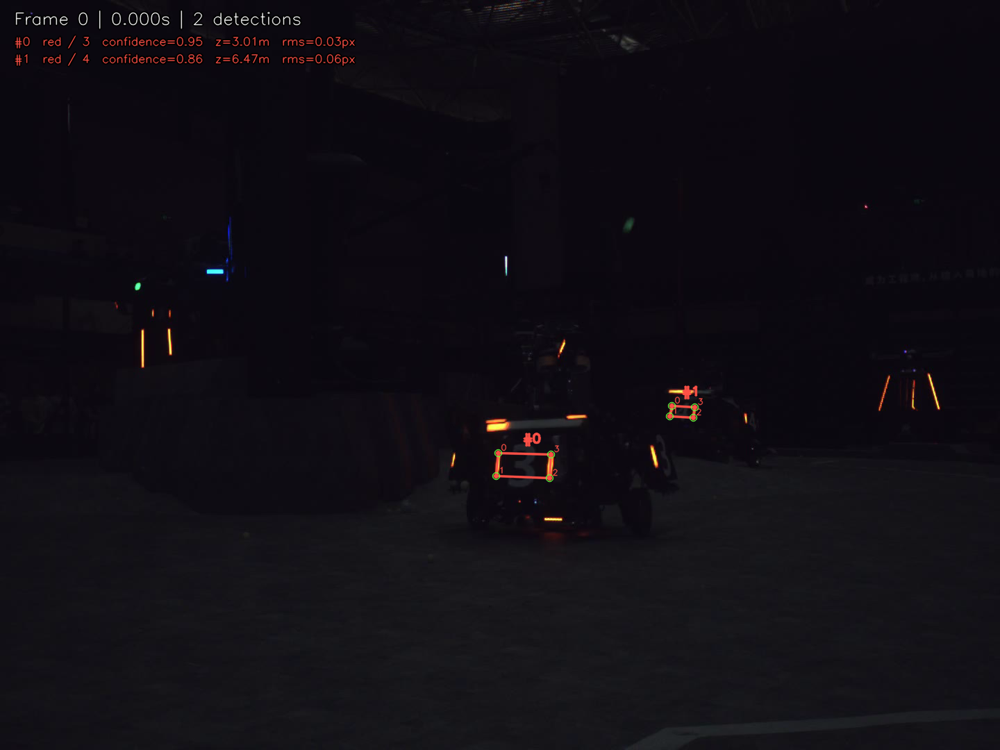
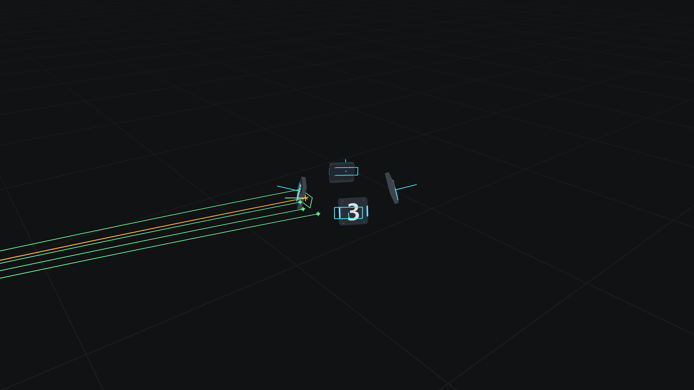

# HerKules 视觉组大作业：检测与预测瞄准

[中文](README.md) · [English](README.en.md)

已实现**路线 A：检测**和**路线 B：预测瞄准**。两条路线各自独立运行；原题只要求任选一条。
路线 A 从视频检测装甲板并导出三维角点，路线 B 根据延迟观测预测未来装甲板位置并在官方仿真器中验证。

- [完整运行说明、算法和参数](detection/README.md)
- [原始检测题目](detection/ASSIGNMENT.md)
- [实现](detection/detect.py) · [测试](detection/tests/test_detection.py) · [输出校验器](detection/validate.py)
- [small.jsonl](detection/results/small.jsonl) · [large.jsonl](detection/results/large.jsonl) · [验证报告](detection/results/validation.json)
- [路线 B 运行说明与算法](aiming/README.md) · [Rust 实现](aiming/src/lib.rs) · [仿真报告](aiming/results/evaluation.json)

## 快速复现路线 A

在仓库根目录运行，推荐 Python 3.12（本次验证版本为 3.12.3）：

```bash
python3 -m venv .venv
.venv/bin/python -m pip install -r detection/requirements.txt

for clip in small large; do
  .venv/bin/python detection/detect.py \
    --model detection/assets/0526.onnx \
    --video "detection/assets/$clip.mp4" \
    --calibration detection/assets/calibration.yaml \
    --output "detection/results/$clip.jsonl" \
    --annotated-video "detection/results/${clip}_annotated.mp4" \
    --preview-dir "detection/results/${clip}_previews"
done

.venv/bin/python -m unittest discover -s detection/tests -v
.venv/bin/python detection/validate.py \
  detection/results/small.jsonl detection/results/large.jsonl \
  --calibration detection/assets/calibration.yaml
```

检测路线的模型、两个视频和标定文件已随模板保存在 `detection/assets/`，不需要训练、GPU 或 ROS。
程序使用 `CPUExecutionProvider`；即使 ONNX Runtime 在启动时提示无法发现 GPU，也不影响 CPU 推理。
MP4 由 OpenCV 编码，不需要单独安装 ffmpeg。标注视频默认不纳入 Git，可用上述命令重新生成。

## 路线 A 验证结果

默认参数：objectness 阈值 0.5、NMS IoU 0.5、最大重投影 RMS 5 像素。

| 输入视频 | 输出帧数 | 检测数 | 有效位姿 | 位姿为 null | 重投影 RMS 中位数 / P95 |
| --- | ---: | ---: | ---: | ---: | --- |
| small.mp4 | 360 | 396 | 396 | 0 | 0.119 / 0.302 px |
| large.mp4 | 360 | 151 | 148 | 3 | 0.275 / 1.822 px |

13 项单元测试全部通过；两份 JSONL 的 720 帧全部通过独立检查，包含帧序、时间戳、类别、
有限数值、正深度、物理尺寸、矩形几何和重投影误差。没有检测的帧也保留记录。
这验证了实现与输出的一致性；数据不提供逐帧真值，不能据此声称检测准确率或真实三维精度。



## 路线 B：预测瞄准

需要 Rust **1.98.1 或更新版本**。本次使用 Rust 1.98.1，保持官方 `src/sim/`、物理常量和依赖锁文件不变。

```bash
cd aiming
cargo test --locked --no-default-features
cargo run --locked --no-default-features --example evaluate
cargo run --locked --no-default-features -- \
  --offline --config scenarios/moving.json --record target/moving.mcap
# 有图形驱动时，可用原生 3D 界面回放
cargo run --locked -- --replay target/moving.mcap
```

控制器补偿观测年龄、20 ms 发射延迟和弹丸飞行时间；先选择装甲板，再固定索引迭代求解。
根据最终三维法线和相对入射速度决定是否开火。缺失观测、不可达或不收敛时不提交指令。

| 官方场景（20 秒） | 发射数 | 命中 | 未命中 | 无效指令 |
| --- | ---: | ---: | ---: | ---: |
| stationary | 80 | 80 | 0 | 0 |
| spinning | 80 | 80 | 0 | 0 |
| moving | 80 | 80 | 0 | 0 |

24 项无界面测试通过，包含 27 组额外运动/自旋/初始相位组合和异常输入检查。
统计前等待全部弹丸结算。100% 命中率仅描述上述精确观测、匀速运动、仅重力弹道的仿真场景。
完整算法、阈值、MCAP 录制/回放和复现步骤见 [aiming/README.md](aiming/README.md)。



## 来源与提交

- [任务页面](https://training.herkules.dev/learn/vision-assignment)
- [官方模板](https://github.com/HKUAstar/vision-training-assignment)，基于提交 `c9fa5e9`。
- [模型及参考实现](https://github.com/broalantaps/RobotDetectionModel)，具体说明见检测目录。

作业使用了 AI 辅助实现与验证，算法流程、参数和失败处理均在文档中说明。
本作业已发布为 [公开 GitHub 仓库](https://github.com/lsyuan777777/vision-assignment)。
正式提交时，在培训网站填写该仓库 URL；网站表单尚未代提交。
