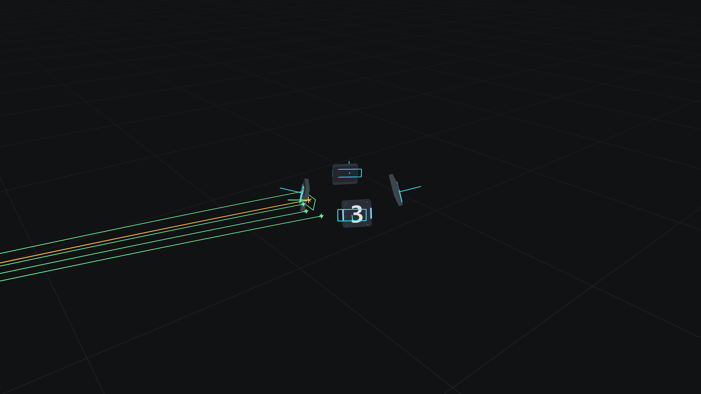

# Route B: predictive aiming

[中文](README.md) · [English](README.en.md) · [Original assignment](ASSIGNMENT.md)

The controller in `src/lib.rs::aim` is complete. It uses only delayed observations supplied through
`Input`. The original simulator, collision evaluator, physical constants, trajectory solver,
scenario files, dependencies and lockfile are unchanged.

## Run

Install Rust **1.98.1 or newer**, a C/C++ compiler and linker. Tested with Rust 1.98.1.
Run these commands from `aiming/`:

```bash
cargo test --locked --no-default-features
cargo run --locked --no-default-features --example evaluate
for scenario in stationary spinning moving; do
  cargo run --locked --no-default-features -- \
    --offline --config "scenarios/$scenario.json" --record "target/${scenario}.mcap"
done
```

Choose a new recording path on repeated runs; MCAP files are never overwritten.
The application's `--offline` means headless simulation, not offline dependency resolution.
To reduce build disk usage, prefix Cargo commands with `CARGO_PROFILE_DEV_DEBUG=0 CARGO_INCREMENTAL=0`.

## Method

1. Reject absent, nonfinite or future observations and invalid geometry.
2. Compute observation age from `now - capture`, then add the 20 ms launch delay.
3. Estimate flight time from range / muzzle speed. Predict all plates at this rough arrival time
   and choose a front-facing plate using its full 3D normal, including mount tilt.
4. Hold that plate index fixed while iterating predicted position and `Trajectory::solve`.
   Use 0.5 relaxation, a maximum of 48 iterations, and a `1e-7 s` time tolerance.
5. Recompute the plate at the returned flight time and require endpoint residual <= `1e-4 m`.
   Missing, unreachable or nonconvergent solutions return `None`.
6. Fire only when `-normal · relative_velocity / |relative_velocity| >= 0.5`.
   Relative velocity includes plate translation and spin. Otherwise track with `fire=false`.

Prediction horizon is `now - capture + launch_delay + flight_time`.
Absolute impact time is `now + launch_delay + flight_time`; do not add observation age again.
The controller is stateless. The evaluator applies the rate limit; hit statistics are only displayed.

## Results and verification

| Official 20-second scenario | Shots | Hits | Misses | Invalid commands |
| --- | ---: | ---: | ---: | ---: |
| stationary | 80 | 80 | 0 | 0 |
| spinning | 80 | 80 | 0 | 0 |
| moving | 80 | 80 | 0 | 0 |

All projectiles are allowed to settle before calculating hit rate. All 24 headless tests pass,
including 27 additional combinations of motion, phase and spin in both directions.
Controller tests also cover observation-age equivalence, gravity compensation, invalid input,
unreachable targets, oblique-entry hold fire and consistent debug endpoints/timestamps.
Two template-only assertions about never firing/drawing markers were adapted to the completed controller;
independent physics/collision tests and exact MCAP round-trip checks remain in place.
Replaying and re-recording the moving MCAP through the official CLI produces identical bytes.

```bash
mkdir -p results
cargo run --locked --no-default-features --example evaluate > results/evaluation.json
cargo fmt --all -- --check
cargo clippy --locked --no-default-features --all-targets -- -D warnings
```

See [evaluation.json](results/evaluation.json) for exact metrics.

## Viewer and replay

Default features enable the native 3D viewer, requiring graphics drivers and platform development libraries.
The numerical evaluation above needs neither a GPU nor a desktop session.

```bash
cargo run --locked -- --config scenarios/moving.json
cargo run --locked -- --replay target/moving.mcap --at 3.65
cargo run --locked -- --replay target/moving.mcap --at 3.65 --preview target/moving.png
# Optional, requires ffmpeg:
cargo run --locked -- --replay target/moving.mcap --export-video target/moving.mp4
```

Cyan plates show the historical observation; green shows the predicted selected plate; orange shows
the ballistic trajectory and impact. Overlays include capture age, flight/impact time, selected index,
incidence cosine, iteration count and endpoint residual. Replay restores recorded commands/drawings.
PNG/MP4 exports include the scene, not UI text or controls.
Local `results/{stationary,spinning,moving}.mcap` recordings are Git-ignored and reproducible with the commands above.

The default viewer build, formatting check and `cargo clippy --locked --all-targets -- -D warnings` pass.
The official renderer successfully exported this 4K snapshot at 3.65 s. Desktop interaction and MP4 export were not exercised.



Results apply to the supplied idealized constant-motion simulation. Noise, acceleration, aerodynamic drag,
real gimbal dynamics and hardware errors are not modeled. Fast rotation/large radius can cause nonconvergence
or an oblique final orientation; the controller holds fire rather than solving all alternative plates.
Implementation and tests used AI assistance. Simulator/template source:
[HKUAstar/vision-training-assignment](https://github.com/HKUAstar/vision-training-assignment).
