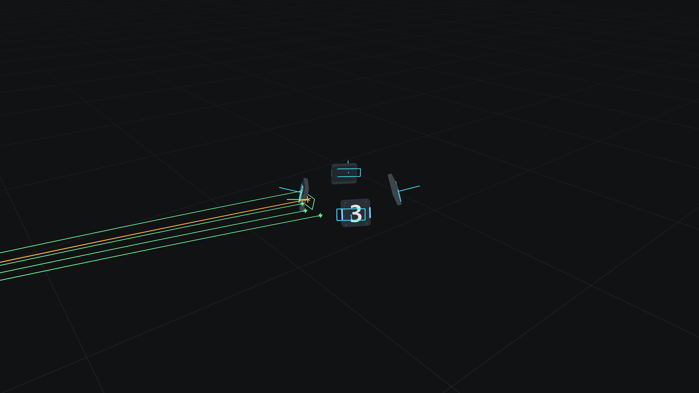

# 路线 B：预测瞄准实现

[中文](README.md) · [English](README.en.md) · [原始题目](ASSIGNMENT.md)

`src/lib.rs::aim` 已实现延迟补偿、装甲板选择、未来位置迭代、低弹道求解和入射角开火判断。
控制器只使用 `Input` 提供的历史观测，不访问仿真当前真值。
官方 `src/sim/`、`src/ui.rs`、物理常量、弹道工具、场景与 Cargo 依赖均保持不变。

## 环境与快速运行

需要 Rust **1.98.1 或更新版本**、C/C++ 编译器和链接器。使用
[官方 rustup](https://rust-lang.org/tools/install/) 安装工具链：

```bash
rustup toolchain install 1.98.1 --profile minimal --component rustfmt --component clippy
```

如果刚安装 Rust，重新打开终端或运行 `source "$HOME/.cargo/env"`。
以下命令在 `aiming/` 目录运行。本次安装使用 1.98.1；可以用 `cargo +1.98.1 ...` 明确选择版本。

```bash
cargo test --locked --no-default-features
cargo run --locked --no-default-features --example evaluate

# 分别录制三个官方场景，不需要桌面环境或 GPU
for scenario in stationary spinning moving; do
  cargo run --locked --no-default-features -- \
    --offline --config "scenarios/$scenario.json" \
    --record "target/${scenario}.mcap"
done
```

MCAP 文件不能覆盖，重复录制请换新路径。`--offline` 是**无界面仿真**选项，不表示 Cargo 禁止联网。
首次构建仍需下载锁定的依赖。磁盘紧张时可给 Cargo 命令添加环境变量
`CARGO_PROFILE_DEV_DEBUG=0 CARGO_INCREMENTAL=0`；本次使用这些设置，不改变代码或评分逻辑。

## 算法

1. 验证观测、时间和几何尺寸。没有观测、时间倒置、非有限数据或无效尺寸时返回 `None`。
2. 计算 `age = now - capture`。从观测状态到预计命中的预测间隔始终是
   `age + LAUNCH_DELAY_S + flight_time`，发射延迟固定为 0.02 秒。
3. 用预计发射时机器人中心到炮口的距离除以 25 m/s，获得初始飞行时间。
   在粗估命中时刻计算四块装甲板，用**完整三维外法线**与“板中心指向炮口”的单位向量点积选出正面板。
4. 固定所选装甲板索引，只对这一块板迭代：预测板位置 → `Trajectory::solve` → 更新飞行时间。
   更新使用 0.5 松弛系数减轻高速自旋时振荡。最多 48 次，飞行时间变化 ≤ `1e-7` 秒才接受收敛。
5. 用最终返回的飞行时间重新计算板姿态，要求弹道终点与预测板中心的距离 ≤ `1e-4` 米。
   不可达、超过官方飞行寿命、未收敛或数值不合法时返回 `None`。
6. 计算相对入射速度 `v_rel = trajectory.velocity(flight) - plate.velocity_m_s`，包括板的平移和旋转速度。
   开火评分为 `-normal · v_rel / |v_rel|`。分数 ≥ 0.5 时请求开火，即与正面入射方向夹角不超过 60°。
   该阈值保留一定入射角余量；分数较低时仍返回瞄准角，但 `fire=false`。

以上是无跨帧可变状态的控制器，每次调用只由输入决定。射速限制交给官方仿真器处理，
不读取或改写命中计数来改变决策。计数仅用于显示。

特别区分三个时间量：

```text
观测年龄：       now - capture
预测间隔：       now - capture + launch_delay + flight_time
绝对命中时刻：   now + launch_delay + flight_time
```

世界坐标遵循 +X 前、+Y 左、+Z 上；yaw 从 +X 朝 +Y 为正，pitch 向上为正。
使用原有低弹道工具，不自行修改重力、弹速、装甲尺寸或碰撞规则。

## 验证结果

完整数据保存在 [results/evaluation.json](results/evaluation.json)，可重新生成：

```bash
mkdir -p results
cargo run --locked --no-default-features --example evaluate > results/evaluation.json
# 也支持评估自己提供的场景
cargo run --locked --no-default-features --example evaluate -- scenarios/moving.json
```

| 场景 | 发射数 | 命中 | 未命中 | 无效指令 | 已结算命中率 |
| --- | ---: | ---: | ---: | ---: | ---: |
| stationary（20 s） | 80 | 80 | 0 | 0 | 100% |
| spinning（20 s，4 rad/s） | 80 | 80 | 0 | 0 | 100% |
| moving（20 s，平移 + 2 rad/s 自旋） | 80 | 80 | 0 | 0 | 100% |

所有评估继续运行到场景时长 + 发射延迟 + 最大飞行时间，确保全部弹丸已结算。
不会用尚未落地的弹丸抬高命中率。官方射速上限为每 0.25 秒一发，三个场景均保持了完整发射机会。
三个场景中的最大弹道终点残差分别约为 `5.6e-17`、`1.0e-7`、`3.3e-8` 米。

24 项无界面测试全部通过。其中新增的 8 项控制器测试覆盖：

- 三个官方场景的命中表现与足够发射次数。
- 27 组运动速度、初始相位和 `-16 / 0 / +16 rad/s` 自旋组合，每组 5 秒，均无未命中。
- 同一目标不同观测年龄产生一致指令，避免写死 50 ms 或重复补偿。
- 静止目标的 yaw 与重力补偿 pitch。
- 缺失、未来、非有限观测与无效尺寸；不可达和炮口位于目标中心的情况。
- 入射角过斜时保持瞄准但不开火。
- 预测中心与弹道终点一致，绝对命中时间不重复添加观测年龄。

原有物理、碰撞、发射时序和轨迹测试保留。两项原本验证“空白模板不开火/不画标记”的测试，
已更新为完成后控制器的行为，同时保留 MCAP 精确序列化、绘图和延迟检查。
移动场景 MCAP 经官方 CLI 读回再写出，与原文件逐字节一致。

```bash
cargo fmt --all -- --check
cargo clippy --locked --no-default-features --all-targets -- -D warnings
```

## 可视化与回放

默认功能包含原生 3D 界面，需要图形驱动和平台窗口开发库；Linux 可使用 Vulkan 驱动。
无界面数值评估不依赖这些图形组件。

```bash
cargo run --locked -- --config scenarios/moving.json
cargo run --locked -- --replay target/moving.mcap --at 3.65
cargo run --locked -- --replay target/moving.mcap --at 3.65 --preview target/moving.png
# 可选：安装 ffmpeg 后，用官方导出器生成 4K、60 FPS 视频
cargo run --locked -- --replay target/moving.mcap --export-video target/moving.mp4
```

青色为观测时刻的四块板，绿色为预计命中时所选板，橙色为弹道与终点。
界面中的诊断信息包含命中计数、所选索引、观测年龄、飞行时间、绝对命中时刻、入射评分、迭代次数和终点残差。
回放恢复录制时的指令和绘图，不重新运行控制器。PNG/MP4 导出只包含 3D 场景，不包含文字控件。

本地已生成 `results/{stationary,spinning,moving}.mcap`。MCAP 被仓库的 `.gitignore` 排除，可用上述命令重建。

默认可视化功能已编译，`cargo fmt --all -- --check` 与启用默认功能的
`cargo clippy --locked --all-targets -- -D warnings` 均通过。移动场景在 3.65 s 的官方 4K 渲染结果如下；
已完成截图导出验证，未操作桌面交互窗口，也未导出 MP4。



## 范围与局限

本结果基于官方精确的延迟观测、匀速平移/自旋模型、固定发射延迟和仅重力弹道。
尚未评估噪声、加速度、空气阻力、实际云台动态或硬件误差。
高速/大半径目标可能导致固定点迭代不收敛，或粗选装甲板最终入射过斜；此时会停止发射，
没有为其他候选板另行穷举弹道。该行为遵循题目“先选板、再固定索引求解”的流程。

实现与测试使用了 AI 辅助。原题与仿真来源为
[HKUAstar/vision-training-assignment](https://github.com/HKUAstar/vision-training-assignment)。
